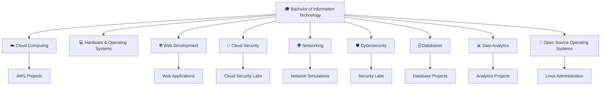

<div align="center">

# 🎓 Dereck Mungoriwo
## Bachelor of Information Technology Portfolio

**Academic Journey · Technical Skills · Professional Development**

*A journey of learning, building, experimenting and growing in Information Technology.*

<br>

[](https://github.com/dereckmungoriwo)
[](https://www.linkedin.com/in/dereckmungoriwo)
[](mailto:dereck@dereckmungoriwo.com)

<br>


</div>

---

## 📑 Table of Contents

| | | |
|---|---|---|
| [✨ About](#-about-this-portfolio) | [🗺️ Specializations](#️-areas-of-specialization) | [📁 Repository Structure](#-repository-structure) |
| [🎓 Academic Journey](#-academic-journey) | [🧭 Learning Map](#-learning-and-technical-development-map) | [🛠️ Technologies](#️-technologies-and-tools) |
| [📚 Technical Areas](#-technical-areas-and-projects) | [🧩 What's Inside](#-whats-inside-this-repository) | [📸 Project Documentation](#-project-documentation) |
| [🚀 Goals](#-professional-development-goals) | [📈 Progress](#-portfolio-progress) | [📬 Connect](#-connect-with-me) |

---

## ✨ About This Portfolio

Welcome to my **Bachelor of Information Technology (BIT) Professional Portfolio**.

This repository documents my academic journey and continuous development as an aspiring IT professional. As I progress through my degree, I use it to showcase the technical knowledge, practical experience, problem-solving abilities and projects I develop across different areas of Information Technology.

My focus is on combining theoretical knowledge with practical implementation, exploring technologies, solving real-world problems and continuously expanding my technical capabilities.

> 💡 **My goal is to transform knowledge into practical solutions, develop industry-relevant skills and build a strong foundation for a career in Information Technology.**

---

## 🎓 Academic Journey

**Qualification:** Bachelor of Information Technology (BIT)  
**Institution:** [Your University Name]

| Academic Level | Focus | Status |
|---|---|---|
| **First Year** | IT Fundamentals and foundational computing concepts | ✅ Completed |
| **Second Year** | IT Specializations and practical technical development | 🔄 In Progress |
| **Third Year** | Advanced IT applications, integrated projects and professional development | ⏳ Upcoming |

---

## 🗺️ Areas of Specialization

My BIT studies cover several areas of Information Technology. This repository organizes my work according to these technical specializations.

| Specialization | Focus Areas |
|---|---|
| ☁️ **Cloud Computing** | Amazon Web Services (AWS), cloud infrastructure and deployment |
| 💻 **Hardware and Operating Systems** | Computer architecture, hardware components and system administration |
| 🌐 **Web Development** | HTML, CSS, JavaScript and enterprise software development |
| 🔐 **Cloud Security** | AWS security, IAM, access management and data protection |
| 🌍 **Networking** | Network infrastructure, protocols, routing and switching |
| 🛡️ **Cybersecurity** | Information security, threat awareness and defensive security |
| 🗄️ **Database Management** | SQL, database design, data modelling and management |
| 📊 **Data Analytics** | Data processing, analysis, visualization and reporting |
| 🐧 **Open Source Operating Systems** | Linux, Ubuntu, command-line tools and system administration |

---

## 🧭 Learning and Technical Development Map

The following diagram illustrates the main technical areas covered in my BIT journey.



---

## 📚 Technical Areas and Projects

*Click any area to expand it.*

<details>
<summary><b>☁️ 01 · Cloud Computing Technologies – AWS</b></summary>

<br>

**Primary platform:** Amazon Web Services (AWS)

**Areas of learning**
- AWS Cloud Fundamentals
- EC2 and Compute Services
- S3 and Cloud Storage
- Virtual Private Cloud (VPC)
- AWS Networking
- IAM and Access Management
- Cloud Infrastructure
- Cloud Deployment

**Projects:** AWS practicals, cloud infrastructure implementations and deployment experiments.

</details>

<details>
<summary><b>💻 02 · Hardware and Operating Systems</b></summary>

<br>

**Areas of learning**
- Computer Hardware Components
- CPU and Memory Architecture
- Storage Technologies
- Operating System Fundamentals
- Hardware Troubleshooting
- System Installation and Configuration
- Windows Administration

**Projects:** Hardware documentation, operating system configurations and troubleshooting exercises.

</details>

<details>
<summary><b>🌐 03 · Web Development and Enterprise Software</b></summary>

<br>

**Areas of learning**
- HTML5
- CSS3
- JavaScript
- Responsive Web Design
- Frontend Development
- Backend Development
- Enterprise Software Concepts
- Web Application Development

**Projects:** Websites, interactive applications and enterprise software implementations.

</details>

<details>
<summary><b>🔐 04 · Cloud Security</b></summary>

<br>

**Areas of learning**
- AWS Security Fundamentals
- Identity and Access Management (IAM)
- Access Control Policies
- Data Protection
- Cloud Security Best Practices
- Security Monitoring
- Cloud Infrastructure Protection

**Projects:** AWS security configurations, access management exercises and cloud security documentation.

</details>

<details>
<summary><b>🌍 05 · Networking</b></summary>

<br>

**Areas of learning**
- Networking Fundamentals
- OSI and TCP/IP Models
- IP Addressing and Subnetting
- Routing and Switching
- Network Topologies
- Network Protocols
- Network Configuration

**Projects:** Network simulations, addressing exercises and network infrastructure documentation.

</details>

<details>
<summary><b>🛡️ 06 · Cybersecurity</b></summary>

<br>

**Areas of learning**
- Information Security Fundamentals
- Security Principles
- Threat Identification
- Vulnerability Assessment
- Risk Management
- Defensive Security
- Security Awareness

**Projects:** Defensive security labs, security research and vulnerability assessment exercises in authorized environments.

</details>

<details>
<summary><b>🗄️ 07 · Database Management</b></summary>

<br>

**Areas of learning**
- Database Fundamentals
- Relational Database Design
- Entity Relationship Diagrams (ERD)
- SQL
- Database Queries
- Database Normalization
- Database Administration

**Projects:** Database designs, SQL exercises and database-driven applications.

</details>

<details>
<summary><b>📊 08 · Data Analytics</b></summary>

<br>

**Areas of learning**
- Data Collection
- Data Cleaning
- Data Processing
- Data Analysis
- Data Visualization
- Statistical Analysis
- Reporting and Interpretation

**Tools:** Excel, SQL, Python and Power BI as I develop my skills.

**Projects:** Data analysis exercises, dashboards and visualization projects.

</details>

<details>
<summary><b>🐧 09 · Open Source Operating Systems</b></summary>

<br>

**Areas of learning**
- Linux Fundamentals
- Ubuntu
- Linux Command Line
- File and Directory Management
- User and Permission Management
- Bash Scripting
- Linux System Administration

**Projects:** Linux practicals, command-line exercises and system administration documentation.

</details>

---

## 📁 Repository Structure

The repository is organized into specialization folders to make academic work, independent projects and technical documentation easy to navigate.

```text
Dereck-Mungoriwo-IT-Portfolio/
│
├── README.md
│
├── 00-Portfolio-Overview/
│   └── README.md
│
├── 01-IT-Fundamentals/
│   └── README.md
│
├── 02-Cloud-Computing-AWS/
│   ├── AWS-Fundamentals/
│   ├── EC2-and-Compute/
│   ├── S3-and-Storage/
│   ├── VPC-and-Networking/
│   └── Cloud-Projects/
│
├── 03-Hardware-and-Operating-Systems/
│   ├── Computer-Hardware/
│   ├── Operating-System-Fundamentals/
│   └── Troubleshooting/
│
├── 04-Web-Development-and-Enterprise-Software/
│   ├── HTML-and-CSS/
│   ├── JavaScript/
│   ├── Web-Applications/
│   └── Enterprise-Projects/
│
├── 05-Cloud-Security/
│   ├── AWS-IAM/
│   ├── Access-Control/
│   └── Cloud-Security-Projects/
│
├── 06-Networking/
│   ├── Networking-Fundamentals/
│   ├── IP-Addressing/
│   ├── Routing-and-Switching/
│   └── Network-Labs/
│
├── 07-Cybersecurity/
│   ├── Security-Fundamentals/
│   ├── Defensive-Security/
│   └── Security-Labs/
│
├── 08-Database-Management/
│   ├── SQL/
│   ├── Database-Design/
│   └── Database-Projects/
│
├── 09-Data-Analytics/
│   ├── Excel/
│   ├── Python-Analytics/
│   ├── Data-Visualization/
│   └── Analytics-Projects/
│
├── 10-Open-Source-Operating-Systems/
│   ├── Linux-Fundamentals/
│   ├── Ubuntu/
│   ├── Linux-Commands/
│   └── Linux-Projects/
│
├── 11-University-Projects/
│   ├── Individual-Projects/
│   └── Group-Projects/
│
├── 12-Personal-Projects/
│   ├── Software-Projects/
│   ├── Cloud-Projects/
│   └── Other-Projects/
│
└── 13-Certifications-and-Professional-Development/
    ├── Certifications/
    ├── Online-Courses/
    └── Technical-Learning/
```

---

## 🧩 What's Inside This Repository

| | Area | What You'll Find |
|---|---|---|
| 📚 | **Academic Work** | Practical exercises, assignments and learning activities from my BIT studies |
| 💻 | **Personal Projects** | Independent projects developed to strengthen my technical abilities |
| ☁️ | **Cloud Computing** | AWS experiments, cloud configurations and infrastructure implementations |
| 🌐 | **Software Development** | Web applications, programming exercises and software solutions |
| 🔐 | **Cybersecurity** | Defensive security exercises and security research |
| 🌍 | **Networking** | Network configurations, simulations and technical documentation |
| 🗄️ | **Database Projects** | Database designs, SQL queries and implementations |
| 📊 | **Data Analytics** | Data analysis, visualization and reporting |
| 🐧 | **Linux and Open Source** | Operating system exercises and administration tasks |

---

## 🛠️ Technologies and Tools

The following technologies represent the platforms and tools I am exploring and developing practical experience with throughout my BIT studies.

| Category | Technologies and Tools |
|---|---|
| ☁️ Cloud Computing | Amazon Web Services (AWS) |
| 🌐 Web Development | HTML5, CSS3, JavaScript |
| 🖥️ Operating Systems | Windows, Linux, Ubuntu |
| 🌍 Networking | TCP/IP, Cisco Packet Tracer |
| 🛡️ Cybersecurity | Security tools and defensive security environments |
| 🗄️ Databases | SQL, MySQL, PostgreSQL |
| 📊 Data Analytics | Microsoft Excel, Python, Power BI |
| 👨‍💻 Programming | Python, JavaScript and other languages as learned |
| 🔀 Version Control | Git and GitHub |

> *Technologies listed here reflect my learning areas and tools of interest. Practical proficiency will be demonstrated through individual projects.*

---

## 📸 Project Documentation

Each major project will include documentation to explain its purpose, implementation and results.

```text
Project-Name/
│
├── README.md
├── documentation/
├── screenshots/
├── source-code/
└── resources/
```

**Each project README will cover:**

1. Project Overview
2. Objectives
3. Problem Statement
4. Technologies Used
5. Implementation Process
6. Screenshots and Results
7. Challenges Encountered
8. Solutions Implemented
9. Skills and Knowledge Gained

---

## 🚀 Professional Development Goals

My long-term goal is to develop into a capable IT professional with a broad technical foundation and practical experience across multiple IT disciplines.

**Areas I intend to strengthen**

- ☁️ Cloud Computing and AWS Infrastructure
- 🛡️ Cloud Security and Cybersecurity
- 🌍 Networking and Systems Administration
- 🌐 Web and Software Development
- 🗄️ Database Management
- 📊 Data Analytics
- 🐧 Linux and Open Source Technologies

I am committed to continuous learning, practical experimentation and developing solutions that address real-world technology challenges.

---

## 📈 Portfolio Progress

This portfolio is a continuous work in progress.

| Area | Progress |
|---|---|
| IT Fundamentals | ✅ Completed |
| Cloud Computing (AWS) | 🔄 In Progress |
| Hardware and Operating Systems | 🔄 In Progress |
| Web Development | 🔄 In Progress |
| Cloud Security | 🔄 In Progress |
| Networking | 🔄 In Progress |
| Cybersecurity | 🔄 In Progress |
| Database Management | 🔄 In Progress |
| Data Analytics | 🔄 In Progress |
| Open Source Operating Systems | 🔄 In Progress |

*Progress indicators will be updated as I complete coursework, practical exercises and projects.*

---

## 📬 Connect With Me

I welcome opportunities to connect with fellow IT students, technology enthusiasts, professionals and potential employers.

| Platform | Link |
|---|---|
| 🐙 **GitHub** | [github.com/dereckmungoriwo](https://github.com/dereckmungoriwo) |
| 💼 **LinkedIn** | [linkedin.com/in/dereckmungoriwo](https://www.linkedin.com/in/dereckmungoriwo) |
| ✉️ **Email** | [dereck@dereckmungoriwo.com](mailto:dereck@dereckmungoriwo.com) |

---

## 📄 Copyright and Academic Integrity

This repository contains my personal learning materials, original projects and academic work that I am permitted to share publicly.

All third-party resources, tools and references remain the property of their respective owners.

Academic submissions and collaborative projects are published only where permitted by the relevant university policies.

---

<div align="center">

### Building Knowledge. Developing Skills. Creating Solutions.

**Dereck Mungoriwo · Bachelor of Information Technology | BIT**

*Every project is an opportunity to learn something new.*

</div>
